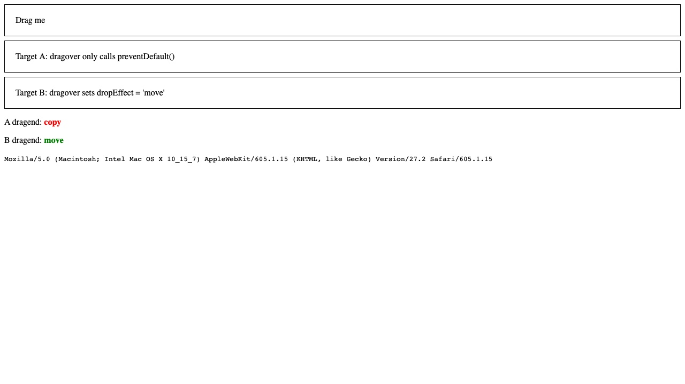
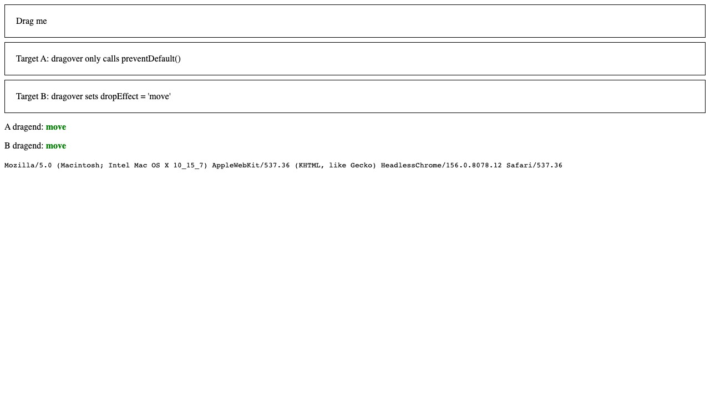
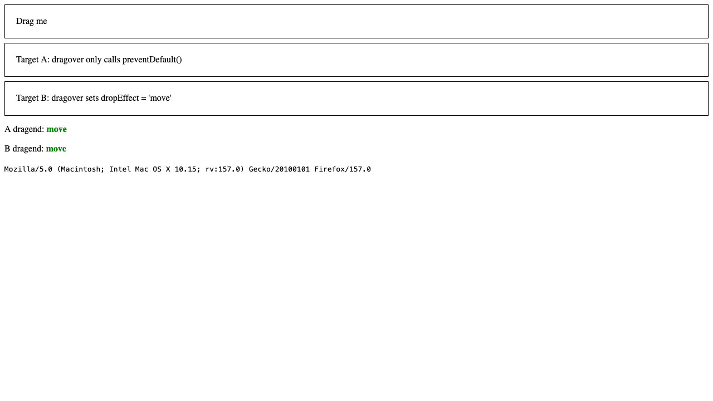
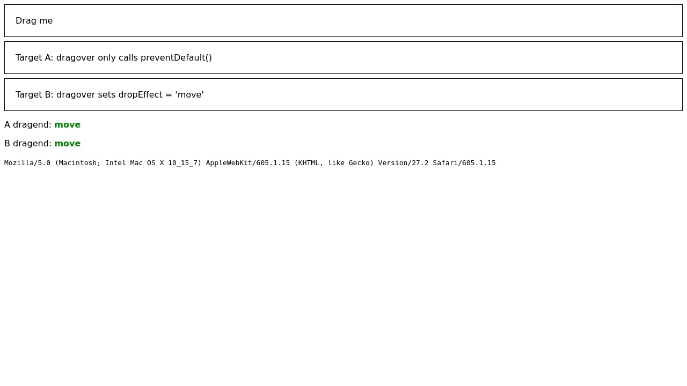
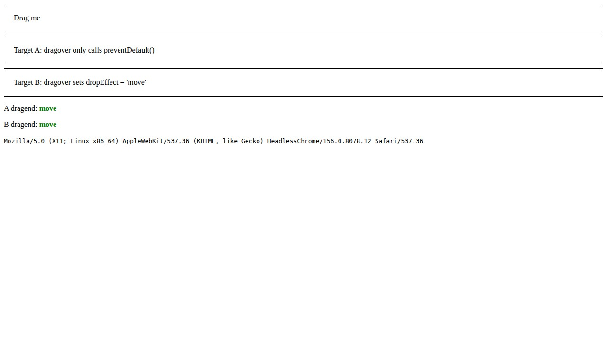
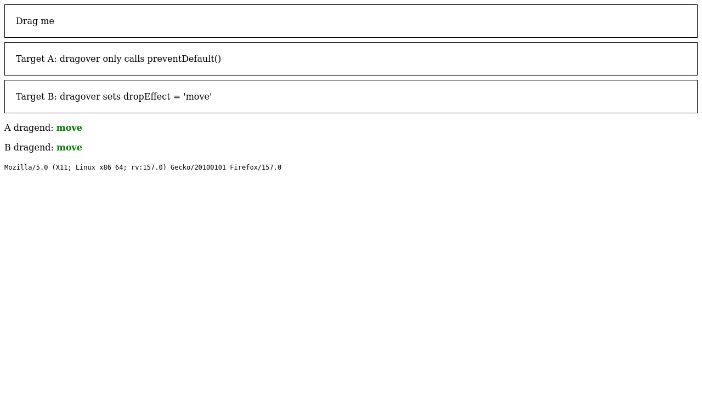

# webkit-copymove-drop-effect

Does WebKit report `dropEffect = 'copy'` instead of `'move'` in `dragend` when the source sets `effectAllowed = 'copyMove'` and the drop target's `dragover` only calls `preventDefault()`?

Derived from [ocavuebot/playwright-drop-effect](https://github.com/ocavuebot/playwright-drop-effect).

- Page: [`docs/index.html`](docs/index.html), online at <https://ocavuebot.github.io/webkit-copymove-drop-effect/>. Open it in Safari, Chrome and Firefox and drag onto each target.
  - Target A: `dragover` only calls `preventDefault()`.
  - Target B (control): `dragover` sets `dropEffect = 'move'`.
- Test: [`tests/drop-effect.spec.js`](tests/drop-effect.spec.js) drags onto both targets, saves a screenshot, and expects `move` in `dragend` for both, using `@playwright/test@1.65.0-alpha-2026-10-15`.
- CI: the [Test workflow](https://github.com/ocavuebot/webkit-copymove-drop-effect/actions/workflows/test.yml) runs on Ubuntu and macOS; the job summary shows the observed values and screenshots are committed to [`screenshots/`](screenshots).

## Results

From [CI run 38852079851](https://github.com/ocavuebot/webkit-copymove-drop-effect/actions/runs/38852079851). Values are `dropEffect` in `dragend`.

| Environment | Target A | Target B |
| --- | --- | --- |
| GitHub Actions macOS v26.6.2, Playwright v1.65.0-alpha-2026-10-15, WebKit 27.2 (build 2376) | `copy` | `move` |
| GitHub Actions macOS v26.6.2, Playwright v1.65.0-alpha-2026-10-15, Chromium 156.0.8078.12 | `move` | `move` |
| GitHub Actions macOS v26.6.2, Playwright v1.65.0-alpha-2026-10-15, Firefox 157.0 | `move` | `move` |
| GitHub Actions Ubuntu v24.04.5 LTS, Playwright v1.65.0-alpha-2026-10-15, WebKit 27.2 (build 2376) | `move` | `move` |
| GitHub Actions Ubuntu v24.04.5 LTS, Playwright v1.65.0-alpha-2026-10-15, Chromium 156.0.8078.12 | `move` | `move` |
| GitHub Actions Ubuntu v24.04.5 LTS, Playwright v1.65.0-alpha-2026-10-15, Firefox 157.0 | `move` | `move` |

## Screenshots

### GitHub Actions macOS v26.6.2, Playwright v1.65.0-alpha-2026-10-15, WebKit 27.2 (build 2376)



### GitHub Actions macOS v26.6.2, Playwright v1.65.0-alpha-2026-10-15, Chromium 156.0.8078.12



### GitHub Actions macOS v26.6.2, Playwright v1.65.0-alpha-2026-10-15, Firefox 157.0



### GitHub Actions Ubuntu v24.04.5 LTS, Playwright v1.65.0-alpha-2026-10-15, WebKit 27.2 (build 2376)



### GitHub Actions Ubuntu v24.04.5 LTS, Playwright v1.65.0-alpha-2026-10-15, Chromium 156.0.8078.12



### GitHub Actions Ubuntu v24.04.5 LTS, Playwright v1.65.0-alpha-2026-10-15, Firefox 157.0



## Run it locally

```sh
npm ci
npx playwright install
npx playwright test
```
